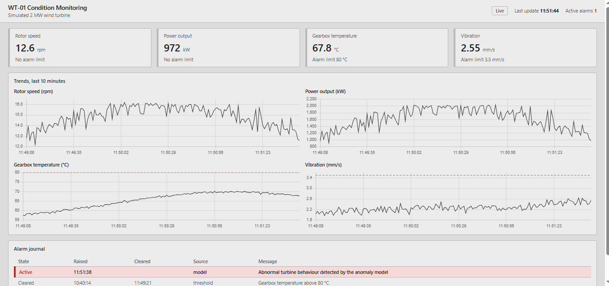
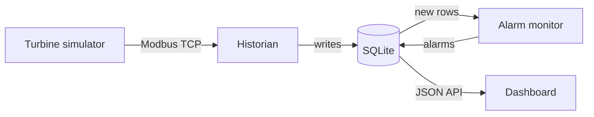
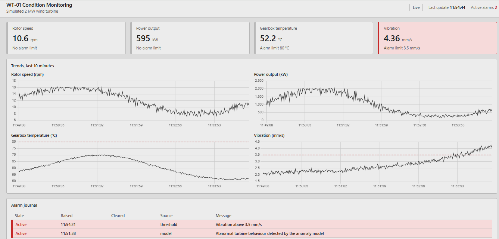
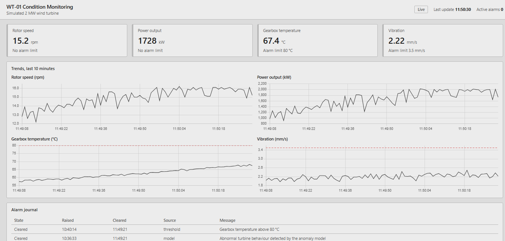

# Wind Turbine Condition Monitoring

A small SCADA-style monitoring chain for a simulated 2 MW wind turbine. The turbine exposes its measurements over Modbus TCP, a historian archives them in SQLite, two detection methods watch for developing faults, and a web dashboard shows live values, trends and an alarm journal.

The project compares a classic fixed-threshold alarm with an Isolation Forest anomaly model on the same simulated faults, and measures how early each one detects them.



## Architecture



| Component | Module | Role |
|---|---|---|
| Turbine simulator | `simulator/` | Physical model (power curve, thermal lag, vibration) with injectable gearbox and bearing faults, served as a Modbus TCP device |
| Historian | `historian/` | Polls the input registers on a drift-free one-second schedule, stores UTC timestamps in SQLite (WAL mode), reconnects automatically after an outage |
| Analytics | `analytics/` | Threshold rules, the anomaly model, an offline evaluation and the live alarm monitor |
| Dashboard | `dashboard/` | Operator screen following ISA-101 high-performance HMI principles |

All programs share one register map (`register_map.py`) and one settings file (`config.py`).

## Modbus register map

Input registers, function code 4, unit ID 1, port 5020.

| Address | Signal | Unit | Scale |
|---|---|---|---|
| 0 | Rotor speed | rpm | ×10 |
| 1 | Power output | kW | ×1 |
| 2 | Gearbox oil temperature | °C | ×10 |
| 3 | Vibration velocity (RMS) | mm/s | ×100 |

## Fault detection

**Threshold alarms.** Gearbox temperature above 80 °C and vibration above 3.5 mm/s. An alarm is raised only after the limit has been exceeded for 10 consecutive seconds (on-delay), and clears only once the value falls below the limit minus a deadband (2 °C and 0.2 mm/s) to prevent chattering. The limits sit above the highest values seen in 24 simulated hours of healthy operation.

**Anomaly model.** An Isolation Forest trained on one hour of healthy data only. Besides the four raw signals, it receives two normal-behaviour residuals: the deviation of gearbox temperature from the value expected for the current power output, and of vibration from the value expected for the current rotor speed. Both expectations come from linear regressions fitted on healthy data. This lets the model flag readings that are abnormal for the current operating point, such as a hot gearbox at low load, before any fixed limit is reached. The decision threshold is set on a separate healthy hour, and the same 10-second on-delay applies.

## Results

Both methods were run on the same simulated scenarios: a 30-minute run with the fault starting after 5 minutes, and 24 hours of healthy operation for false alarms. The scenarios use different random seeds from the training and threshold data.

| Scenario | Threshold alarms | Isolation Forest |
|---|---|---|
| Gearbox fault, detection delay | 200 s | 128 s |
| Bearing fault, detection delay | 147 s | 49 s |
| Healthy 24 h, false alarms | 0 | 0 |

The model detects the gearbox fault 72 s earlier and the bearing fault three times faster, with no false alarms for either method. The results are reproducible with `python -m analytics.evaluate`.

In live runs the same pattern holds. During a bearing fault, the model alarm appeared while vibration was still well below 3.5 mm/s, and the threshold alarm followed a few minutes later:



## Dashboard



- Live values with units and fixed precision; a tile turns red only when its value exceeds the alarm limit
- Ten-minute trends with the alarm limit drawn as a dashed line
- Alarm journal with raise and clear times, active alarms first
- Data freshness indicator: the status changes to "Data stale" if no new reading has arrived for 5 seconds

The display uses a neutral grey palette and reserves colour for abnormal states. Chart.js is bundled with the project, so the dashboard runs without internet access.

## Getting started

Requires Python 3.14.

```bash
python -m venv .venv
# Windows: .venv\Scripts\activate
# Linux/macOS: source .venv/bin/activate
pip install -r requirements-dev.txt
```

Train the anomaly model once (a few seconds):

```bash
python -m analytics.anomaly
```

Start each program in its own terminal, in this order:

```bash
python -m simulator.server --fault gearbox --fault-start 120   # or --fault bearing, or no fault
python -m historian.poller
python -m analytics.monitor
python -m dashboard.app
```

Then open http://127.0.0.1:5000. `--seed` makes a simulator run repeatable.

Compare the two detection methods offline:

```bash
python -m analytics.evaluate
```

## Tests

```bash
python -m pytest
```

The test suite covers the turbine model, register encoding, the database, a polling cycle, the alarm rules, the anomaly model, the alarm monitor and the dashboard API.

## Project structure

```
├── simulator/        turbine model and Modbus TCP server
├── historian/        Modbus polling client and SQLite storage
├── analytics/        threshold rules, anomaly model, evaluation, live monitor
├── dashboard/        Flask application, template, CSS and JavaScript
├── tools/            manual Modbus read utility
├── tests/            pytest suite
├── docs/images/      dashboard screenshots
├── config.py         connection and file settings
└── register_map.py   Modbus register map and value conversion
```

## Limitations

- All data is simulated. The physics is simplified, and faults develop over minutes instead of days or weeks so they can be demonstrated.
- SQLite and the Flask development server stand in for an industrial historian and a production web server.
- In a real plant the anomaly model would be trained on historian data from a period confirmed healthy, not on simulator output.

## License

MIT

## Author

Ali Bouzaienne